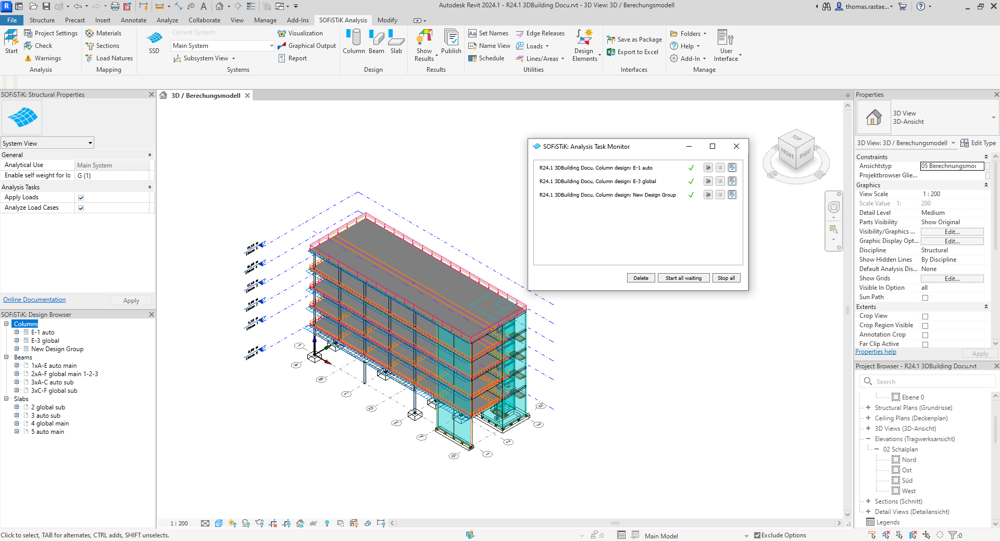
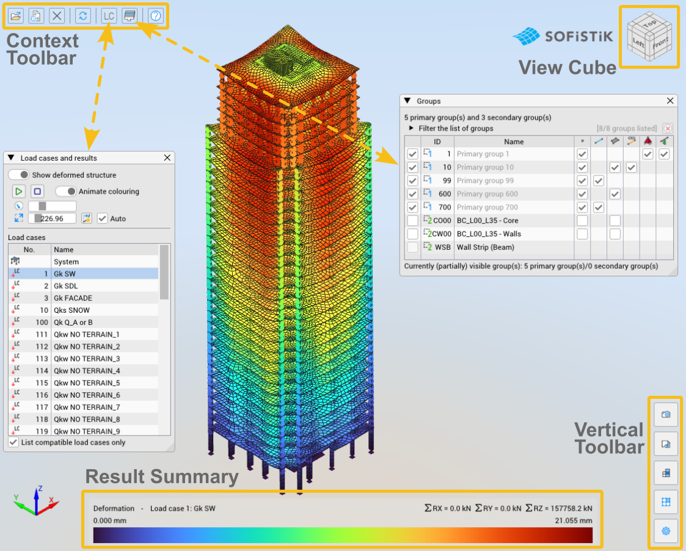
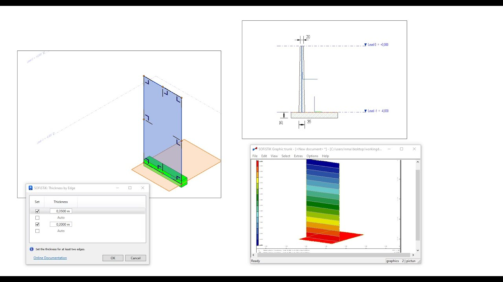

# SOFiSTiK Links Parametric Models With Structural Analysis

SOFiSTiK FEA supports structural modelling, calculation, and design workflows for buildings and infrastructure.
Keep the geometry, analytical assumptions, calculation input, and issued results connected to the same project revision.

## Decide where the analytical model is authored

A SOFiSTiK BIM workflow starts with a decision about which representation controls the analysis.
Physical building components, analytical members, and finite elements serve different purposes.
Review connectivity, eccentricities, supports, and local axes when moving between those representations.

For SOFiSTiK Revit projects, the [Analysis + Design product page](https://www.sofistik.com/en/products/bim-cad/analysis-design-for-revit) describes the integrated building workflow.
Record which model changes must be reviewed before regenerating calculation input.
Check the transferred member identities and load assignments after an update.

The official [Grasshopper interface repository](https://github.com/SOFiSTiK/gh_sofistik) describes components that turn attributed geometry into SOFiSTiK input.
Its published code is an older interface reference; match component behavior to the installed product version.
Use an explicit handoff between parametric geometry and the model being calculated.

Two supplied dependency references illustrate geometry support in a separate modelling codebase.
[FindGMSH.cmake](CMake/FindGMSH.cmake) locates Gmsh headers and libraries.
[FindGNUGTS.cmake](CMake/FindGNUGTS.cmake) locates the GNU triangulation library.

[](https://sofistik-fea.github.io/SOFiSTiK-Software/)

## Make parameter changes visible in the input

Use CADINP where a text-based definition makes an assumption or repeated operation easier to review.
Keep names descriptive and document the units associated with geometric or loading quantities.
A parameter change should have an identifiable effect in the generated input and resulting model.

This small CADINP TEMPLATE block checks arithmetic for five bays of an illustrative length:

```cadinp
+PROG TEMPLATE
HEAD Bay length parameter review
LET#BAYS 5
LET#BAYLEN 6.0
LET#TOTAL #BAYS*#BAYLEN
PRT#TOTAL
END
```

The expected printed total is 30 in the same length unit as BAYLEN.
This block checks parameters; it does not define or solve a structure.
The [LET# reference](https://docs.sofistik.com/2026/en/cdb_interfaces/cadinp/template/let_sto.html) describes variable assignment.
The [PRT# reference](https://docs.sofistik.com/2026/en/cdb_interfaces/cadinp/template/prt.html) describes printing values into the calculation output.



Retain the text input and its generating model together when a geometry script produces the DAT file.
Record the software revision used to generate and interpret that input.

The template [version.cc.in](CMake/version.cc.in) embeds version strings in the companion codebase.
The helper [GetGitRevisionDescription.cmake](CMake/GetGitRevisionDescription.cmake) obtains revision information from Git.
The configuration [find_packages.cmake](CMake/find_packages.cmake) collects dependency-discovery calls.
These references illustrate how an implementation can record its environment separately from engineering input.

## Run a defined calculation and inspect its protocol

After saving the TEMPLATE example as parameter-check.dat, use SOFiSTiK's SPS executable to process it.
With the installed SOFiSTiK executable directory available on PATH, PowerShell can run:

```powershell
sps.exe "parameter-check.dat" -B
```

The [batch-calculation options](https://docs.sofistik.com/2026/en/fea/calculation/special_features_start.html) document SPS and the protocol-display option.
Check the protocol for the printed parameter and any messages.
For a structural calculation, also confirm the required model, load, analysis, and design modules are present in the intended sequence.

### Static response and numerical controls

For SOFiSTiK structural analysis, check restraints, mechanisms, load balance, and a simple reference response.
Inspect the effect of element discretization before relying on local result peaks.
Record nonlinear settings and construction-stage assumptions when they affect the calculation.

The companion modules show several distinct numerical dependency searches:

- [FindSuperLU.cmake](CMake/FindSuperLU.cmake) searches for SuperLU and its supporting requirements.
- [FindUmfpack.cmake](CMake/FindUmfpack.cmake) locates the UMFPACK library.
- [FindMUMPS.cmake](CMake/FindMUMPS.cmake) locates the double-precision MUMPS library.
- [FindSuiteSparse.cmake](CMake/FindSuiteSparse.cmake) discovers SuiteSparse components.
- [FindMETIS.cmake](CMake/FindMETIS.cmake) searches for METIS headers.
- [FindPetsc.cmake](CMake/FindPetsc.cmake) uses PETSc installation settings to locate dependencies.

These searches identify implementation prerequisites; a chosen solver still needs an appropriate and well-defined model.

### Modal response and mass assumptions

Review the mass distribution and boundary conditions before interpreting periods or mode shapes.
Check whether low-frequency motion represents the intended structural behavior or an unintended freedom.
Keep the eigenvalue results associated with the exact stiffness and mass model used.

[FindArpack.cmake](CMake/FindArpack.cmake) locates an ARPACK library.
[FindArpackPP.cmake](CMake/FindArpackPP.cmake) searches for ARPACK++ headers and a library.
[FindSpectra.cmake](CMake/FindSpectra.cmake) searches for Spectra eigensolver headers.
They provide implementation references for distinguishing an eigenvalue dependency from a structural modelling assumption.



## Separate calculation storage from an engineering deliverable

SOFiSTiK Software uses several project artifacts with different roles.
Identify the input and result revision before exporting figures, reading database records, or continuing a design workflow.

| Artifact | Role in the workflow | Context to retain |
| --- | --- | --- |
| DAT input | Text definitions and program sequence | Parameters and referenced input |
| CDB database | Structured model and result records | Record definitions, identifiers, and units |
| Calculation protocol | Messages and numerical output | Module sequence and calculation status |
| Issued report | Selected evidence for review | Cases, combinations, assumptions, and revision |

The [CDB-interface overview](https://docs.sofistik.com/2026/en/cdb_interfaces/introduction/about_manual.html) describes the supported programming interfaces.
Use the documented record structures when building a result-reading utility.
Keep member, node, case, and combination identifiers explicit rather than interpreting values without their keys.

The supplied database-discovery modules demonstrate that storage dependencies are separate implementation choices.
[FindBerkeleyDB.cmake](CMake/FindBerkeleyDB.cmake) searches for Berkeley DB.
[FindSQLITE3.cmake](CMake/FindSQLITE3.cmake) locates SQLite headers and libraries.
[FindMySQL.cmake](CMake/FindMySQL.cmake) discovers MySQL client dependencies.
[FindORACLE.cmake](CMake/FindORACLE.cmake) searches for Oracle OCI dependencies.

Do not infer a calculation database's schema from the presence of a database library.
Read the SOFiSTiK CDB documentation for the records needed by the task.

## Present results at a scale that supports review

Select cases and combinations that answer the stated design question.
Show units, component directions, and relevant locations with each result.
Compare reactions and deformation patterns with the intended load path before discussing design utilization.

A local maximum may need a closer mesh or modelling review before it becomes a report conclusion.
Preserve enough context to distinguish a numerical concentration from the response being assessed.
For bridge or staged-construction work, state which stage or configuration produced the displayed result.

The image dependency search [FindCImg.cmake](CMake/FindCImg.cmake) locates a CImg header.
The plotting search [FindPlot.cmake](CMake/FindPlot.cmake) locates plotter headers and a library.
These references concern presentation infrastructure; a clear plot also needs meaningful engineering labels.



## Related Search Terms

SOFiSTiK FEA, SOFiSTiK Software, SOFiSTiK BIM, SOFiSTiK Revit, SOFiSTiK structural analysis, finite-element-analysis, structural-engineering, structural-analysis, bim, parametric-modeling, bridge-engineering, modal-analysis, reinforced-concrete, prestressed-concrete, automation
